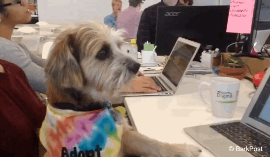

<div align="center">

  [](https://git.io/typing-svg)

  [](https://github.com/piyushsuthar/github-readme-quotes)

</div>

<div align="center">

  

</div>

## :computer: About Me

<div align="center">

  [](https://github.com/DoubledDoge)
  [](https://github.com/DoubledDoge)
  [](https://github.com/DoubledDoge)

  

  <picture>
  <source media="(prefers-color-scheme: dark)" srcset="assets/github-snake-dark.svg" />
  <source media="(prefers-color-scheme: light)" srcset="assets/github-snake.svg" />
  
  </picture>

</div>


<table align="center" width="80%">
  <tr>
  <td width="50%">

  ```yaml
  full_name: Dihan Britz
  title: Third year IT student
  age: 21
  gender: male
  country: South Africa
  status: Just Chilling (It never updates)
  currently_learning:
    - How to stop procrastinating
    - I guess I'm trying to align the website with this readme still
    - Surprisingly nothing else serious at the moment
  hobbies:
    - Hiking & Camping whenever I feel like it
    - Reading up on coding tutorials
    - Drinking too much coffee
    - Listening to music that sounds good
  favourite games:
    - Undertale
    - Super Mario Galaxy (1/2)
    - Clair Obscur: Expedition 33
    - Final Fantasy 10
    - Trails in the Sky 2nd Chapter (Remake)
  ```

  </td>

  <td>

  

  

  </td>
  </tr>
</table>

## :bar_chart: My GitHub Stats

<div align="center">

  [](https://git.io/streak-stats)

</div>

## :hammer_and_wrench: My Skills & Tools

### Absolute Favourites

[](https://skillicons.dev)

### Languages & Tech

[](https://skillicons.dev)

### Tools

[](https://skillicons.dev)

### Operating Systems

[](https://skillicons.dev)

## :dog: Dog Gifs I've Collected

<div align="center">

  _Obviously the most important section of my entire profile._

</div>

<table align="center">
  <tr align="center">
  <td width="200">

  
  <sub><b>me @ 7am</b></sub>

  </td>

  <td width="200">

  
  <sub><b>breaking production code in real time</b></sub>

  </td>

  <td width="200">

  
  <sub><b>questioning my life choices</b></sub>

  </td>
  </tr>

  <tr align="center">
  <td>

  
  <sub><b>"just one more hour to go"</b></sub>

  </td>

  <td>

  
  <sub><b>me on my first interview</b></sub>

  </td>
  
  
  <td>

  
  <sub><b>seeing spaghetti code for the first time</b></sub>

  </td>
  </tr>
</table>

## :fish: A random koi fish for some reason

<div align="center">

  

</div>

## :globe_with_meridians: Connect With Me (I guess)

<div align="center">

  [](https://github.com/DoubledDoge)
  [](https://discord.com/users/1186273583547297804)
  [](https://www.linkedin.com/in/dihan-britz/)
  [](https://gravatar.com/doubleddoge)

</div>

---

<div align="center">

  ```text
  ██████╗  ██████╗ ██╗   ██╗██████╗ ██╗     ███████╗██████╗ ██████╗  ██████╗  ██████╗ ███████╗
  ██╔══██╗██╔═══██╗██║   ██║██╔══██╗██║     ██╔════╝██╔══██╗██╔══██╗██╔═══██╗██╔════╝ ██╔════╝
  ██║  ██║██║   ██║██║   ██║██████╔╝██║     █████╗  ██║  ██║██║  ██║██║   ██║██║  ███╗█████╗  
  ██║  ██║██║   ██║██║   ██║██╔══██╗██║     ██╔══╝  ██║  ██║██║  ██║██║   ██║██║   ██║██╔══╝  
  ██████╔╝╚██████╔╝╚██████╔╝██████╔╝███████╗███████╗██████╔╝██████╔╝╚██████╔╝╚██████╔╝███████╗
  ╚═════╝  ╚═════╝  ╚═════╝ ╚═════╝ ╚══════╝╚══════╝╚═════╝ ╚═════╝  ╚═════╝  ╚═════╝ ╚══════╝
  ```

</div>


